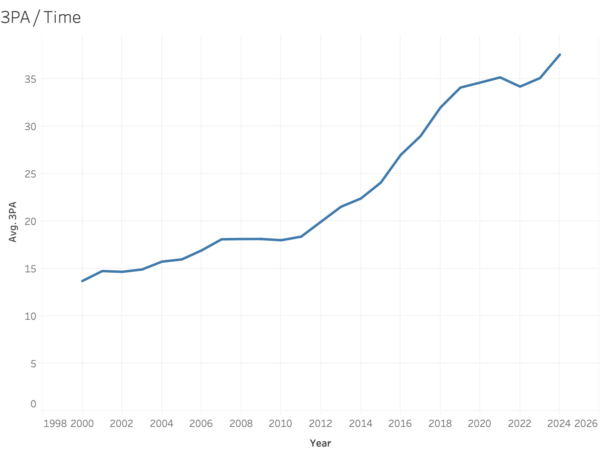
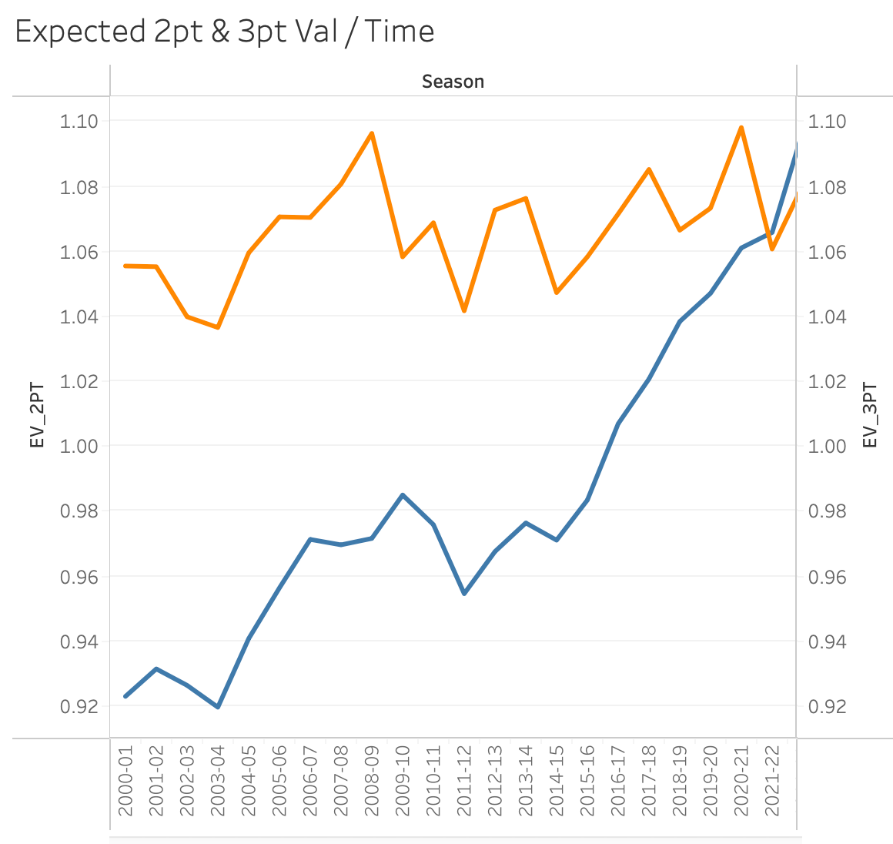
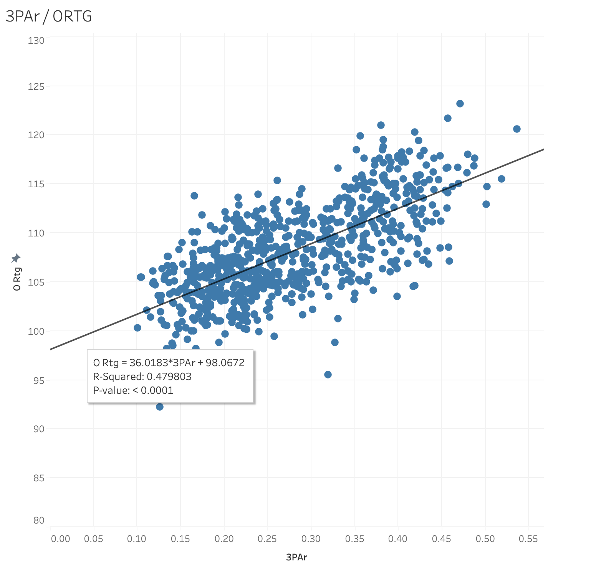
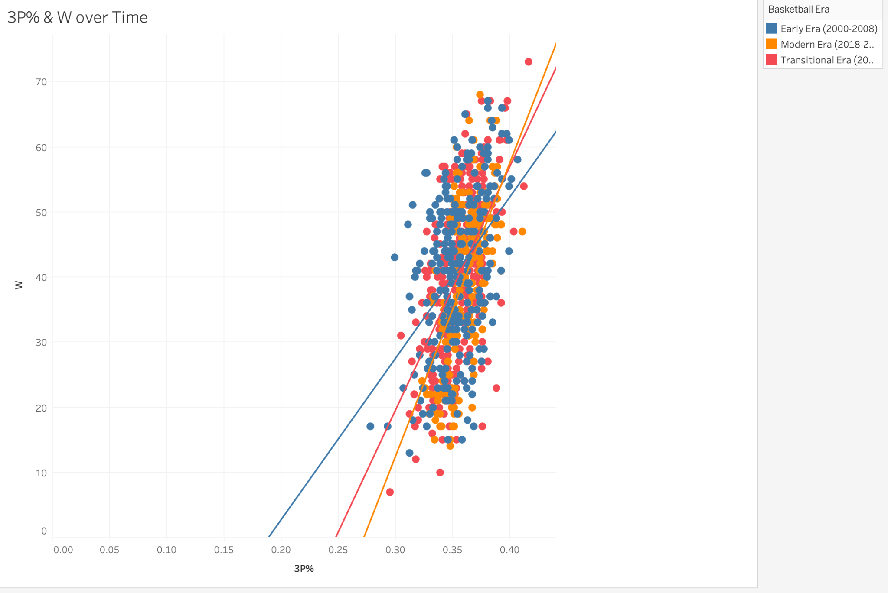
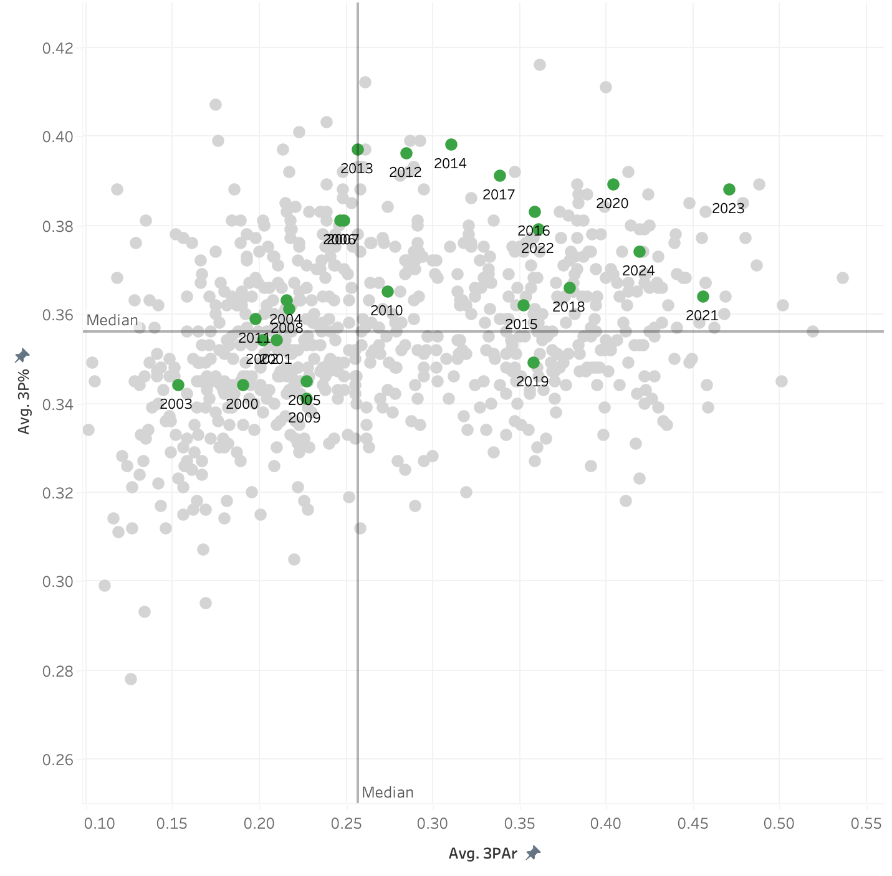

# NBA Three-Point Era Analysis

How has the three-pointer changed the NBA, and does shooting more of them actually help teams win?

This project looks at **25 seasons of team-level data (2000-01 to 2024-25)**. It tracks the rise of the three-point shot and measures how closely three-point volume and efficiency relate to offensive efficiency, winning, and championships.

**Tools:** Python (pandas, pathlib) for data cleaning; Tableau for visualization and regression.
<!-- If you publish the workbook: **[Interactive dashboard on Tableau Public](https://public.tableau.com/...)** -->

## Key findings

| Question | Finding |
|---|---|
| How has 3-point volume changed? | Average 3PA per game rose steadily every era from 2000 to 2025. |
| How has scoring efficiency changed? | Expected points per 3PA held roughly flat as volume grew. Expected points per 2PA climbed, and the two have nearly converged in recent seasons. |
| Is 3-point attempt rate linked to offensive efficiency? | Moderately strong positive relationship: **R² ≈ 0.48, p < 0.0001** (3PAr vs. Offensive Rating). |
| Has 3-point shooting become more tied to winning? | Yes. R² between 3-point efficiency and wins rose across eras: **0.18 → 0.31 → 0.35**. |
| What sets champions apart? | Early-2000s champions were below the league median in both 3PT volume and efficiency. Since about 2015, champions have been almost exclusively high-volume **and** high-efficiency teams. |







## Data

Team per-game and advanced stats come from [Basketball-Reference](https://www.basketball-reference.com/), two CSVs per season (50 files total):

```
data/2000-01_per_game.csv
data/2000-01_advanced.csv
...
```

## Data preparation

`build_dataset.py` turns the 50 raw files into one clean table, `data/nba_master.csv`. It:

1. Loads each season's per-game and advanced tables and removes repeated header rows and league-average rows
2. Merges the two tables on team and season
3. Keeps the relevant stats (3PA, 3P%, 3PAr, TS%, ORtg, Pace, W/L, …)
4. Tags each season's champion
5. Maps old franchise names to current ones (e.g. Seattle SuperSonics → Oklahoma City Thunder)

```bash
pip install -r requirements.txt
python build_dataset.py
```

`nba_master.csv` was then loaded into Tableau for all charts and regressions.

## Limitations & next steps

- The eras for the wins analysis were chosen somewhat arbitrarily. Splitting at different points could shift the R² values.
- 3PAr explains about half the variance in offensive rating. Turnovers, offensive rebounding, and shot quality likely account for much of the rest.
- Possible extensions: rebuild the regressions in Python (statsmodels) so the whole pipeline is reproducible, and look at which teams adopted the high-volume style earliest.
